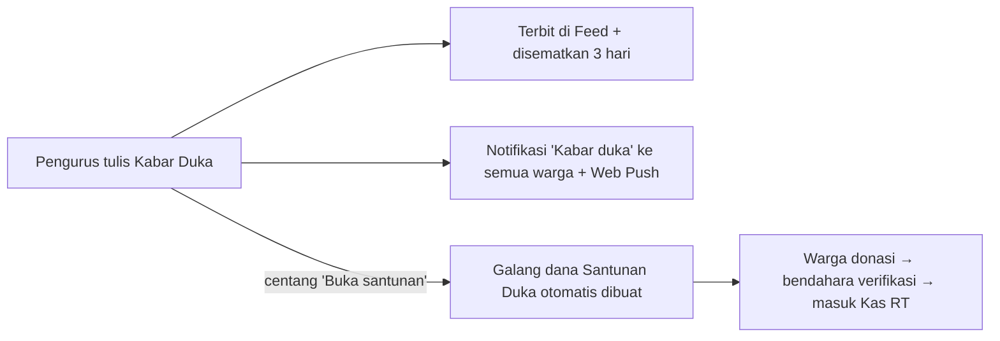
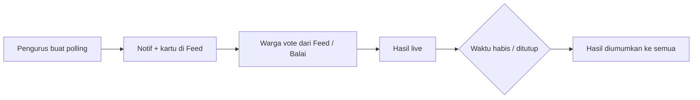
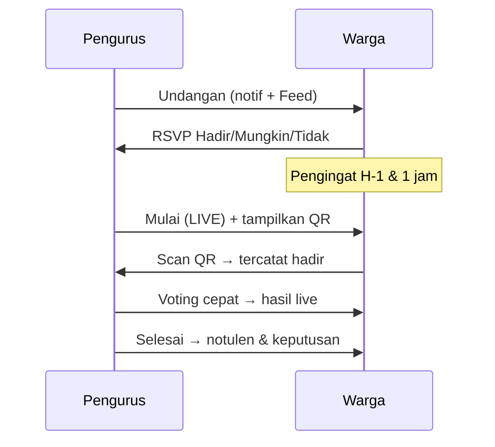
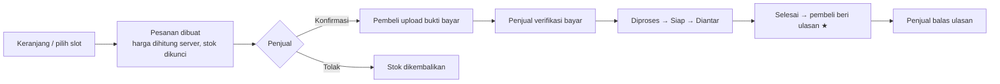
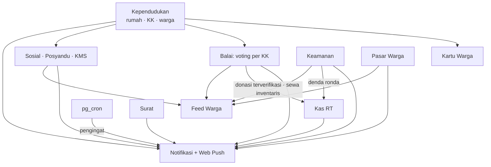

# WargaIn — Fitur & Alur Aplikasi

WargaIn adalah aplikasi komunitas RT/RW (cluster, kavling, maupun kampung) yang menggabungkan administrasi RT, keamanan lingkungan, kegiatan sosial, ekonomi warga, dan musyawarah dalam satu aplikasi. Desainnya **mobile-first** (bottom sheet, tab lengket, tombol besar, safe-area iPhone), tetapi tetap rapi di tablet dan laptop. Semua teks memakai Bahasa Indonesia dan semua waktu memakai **WIB (Asia/Jakarta)**.

> Contoh data demo: **RT 02/03 Cluster Madrid, Mutiara Gading City (Babelan)**, 150 warga, 105 akun login.

---

## Daftar isi

1. [Peran pengguna](#1-peran-pengguna)
2. [Fondasi: Feed, Notifikasi, Web Push, Pengingat Otomatis](#2-fondasi-platform)
3. [Akun, Tenant & Login](#3-akun-tenant--login)
4. [Feed Warga](#4-feed-warga)
5. [Balai Warga — Kabar, Polling, Musyawarah, Galang Dana, Inventaris, Kontak](#5-balai-warga)
6. [Kartu Warga Digital](#6-kartu-warga-digital)
7. [Keamanan Lingkungan](#7-keamanan-lingkungan)
8. [Kegiatan Sosial, Posyandu & KMS Digital](#8-kegiatan-sosial-posyandu--kms-digital)
9. [Pasar Warga](#9-pasar-warga)
10. [Kas & Iuran RT](#10-kas--iuran-rt)
11. [Layanan Surat RT](#11-layanan-surat-rt)
12. [Kependudukan & GIS](#12-kependudukan--gis)
13. [Aplikasi di HP (PWA)](#13-aplikasi-di-hp-pwa)
14. [Keterhubungan antar-modul](#14-keterhubungan-antar-modul)
15. [Operasional & Deploy](#15-operasional--deploy)

---

## 1. Peran pengguna

| Peran | Kode | Kewenangan utama |
|---|---|---|
| Admin tenant | `TENANT_ADMIN` | Semua fitur pengurus, pengaturan komunitas & langganan |
| Ketua RT | `KETUA` | Semua fitur pengurus: musyawarah, polling, keputusan, verifikasi |
| Sekretaris | `SEKRETARIS` | Surat, data warga, notulen, inventaris, kontak |
| Bendahara | `BENDAHARA` | Kas, tagihan, verifikasi pembayaran & donasi |
| Humas | `HUMAS` | Pengumuman, kabar, kegiatan |
| Warga | `ANGGOTA` | Memakai layanan: bayar iuran, ajukan surat, vote, RSVP, donasi, pinjam, belanja |
| Petugas keamanan | (mode Petugas di modul Keamanan) | Command center, gerbang, ANPR, ronda, serah terima shift |

Kelima peran pertama disebut **pengurus** (`PENGURUS_ROLES`). Akun warga terhubung ke data penduduk (`citizenId`) sehingga aplikasi tahu **rumah/KK** warga tersebut. Hubungan ini dipakai untuk notifikasi per rumah, voting "1 rumah 1 suara", dan kartu warga.

---

## 2. Fondasi platform

Semua modul memakai tiga layanan bersama, sehingga modul baru langsung terhubung.

### 2.1 Notifikasi (`notify()`)

- Target penerima bisa: semua warga, akun tertentu, peran tertentu (mis. pengurus), rumah tertentu, atau blok.
- Setiap jenis notifikasi punya **prioritas**: Info, Normal, Penting, atau Darurat.
  - Notifikasi **Darurat** (panic, bencana, anak hilang) selalu terkirim dan mengabaikan preferensi.
- Warga bisa mengatur notifikasi per modul dan per jenis di ikon lonceng → Pengaturan.
- `dedupeKey` mencegah notifikasi ganda. Misalnya pengingat yang dijalankan ulang tetap terkirim satu kali saja.
- Lonceng notifikasi di header setiap modul bersifat realtime (Supabase Realtime).

### 2.2 Feed (`publishFeedPost()`)

- Modul menerbitkan "kartu" ke Feed warga: kegiatan, keamanan, produk, polling, musyawarah, galang dana, dan kabar.
- Satu entitas memiliki satu post. Jika status berubah, post diperbarui di tempat, bukan dibuat post baru.
- Setiap jenis post punya tampilan sendiri (renderer). Jenis yang belum dikenal otomatis tampil sebagai teks.

### 2.3 Web Push

- Notifikasi tetap masuk ke HP walaupun aplikasi ditutup (VAPID + service worker `public/sw.js`).
- Di iPhone, WargaIn harus dipasang ke Layar Utama dulu (lihat [PWA](#13-aplikasi-di-hp-pwa)).
- Aktifkan di lonceng → "Aktifkan notifikasi HP". Tersedia juga tombol kirim tes.

### 2.4 Pengingat otomatis (pg_cron)

Supabase `pg_cron` + `pg_net` memanggil `POST /api/cron/reminders` dengan header `Authorization: Bearer CRON_SECRET`.

| Job | Jadwal | Isi |
|---|---|---|
| `wargain-event-reminders` | tiap jam, menit ke-5 | H-1 kegiatan sosial; H-1 booking/pre-order Pasar; **H-1 & 1 jam sebelum musyawarah**; menutup polling yang habis waktunya dan mengumumkan hasil; pengingat batas kembali inventaris |
| `wargain-immunization-reminders` | harian 07.00 WIB | Jadwal imunisasi anak yang jatuh tempo atau terlambat |

- Selama **jam tenang 21.00–06.00 WIB** tidak ada pengingat non-darurat.
- URL aplikasi dan secret disimpan di Supabase Vault (`wargain_app_url`, `wargain_cron_secret`). Keduanya diatur lewat `scratch/set-cron-config.mjs`.

---

## 3. Akun, Tenant & Login

- **Daftar tenant** (`/register`): pengurus mendaftarkan komunitasnya lalu memilih paket (RT Standard, RW Pro, Enterprise) dan mengonfirmasi pembayaran langganan.
- **Login** (`/login`) memakai email dan password. Sesi menyimpan komunitas, peran, `citizenId`, dan blok rumah.
- Setelah login, pengguna dikembalikan ke halaman asal lewat parameter `?next=`, misalnya setelah scan QR absen musyawarah atau QR kartu warga.

---

## 4. Feed Warga

`/feed` adalah beranda warga.

- **Filter:** Semua, Pengumuman (termasuk kabar warga), Musyawarah & Polling, Kegiatan, Keamanan, dan Jual Beli.
- **Menulis post:** info umum, pengumuman (pengurus), jual-beli, dan aduan warga.
- Suka, komentar, sematkan (pin), sembunyikan, dan tandai aduan "selesai ditangani".
- Realtime: post dan komentar baru muncul tanpa perlu refresh.
- **Interaksi langsung di Feed:** vote polling, RSVP musyawarah, daftar kegiatan, pesan produk, dan donasi.

---

## 5. Balai Warga

`/balai` adalah pusat suara dan kabar warga. Halaman ini punya enam tab dengan badge jumlah item yang perlu ditindaklanjuti. Tombol aksi melayang (FAB) menyesuaikan tab yang sedang dibuka. Bagian hero menampilkan ringkasan: polling yang menunggu suara Anda, musyawarah terdekat, galang dana aktif, dan jumlah barang RT.

### 5.1 Kabar Terbaru

Kategori kabar: 📣 Info · 🕊️ Duka · 👶 Kelahiran · 💍 Pernikahan · 🏥 Warga Sakit · 🏆 Prestasi · 🏡 Warga Baru · ⚡ Gangguan Layanan (listrik/air).

- Setiap warga bisa menulis kabar. Kabar dari pengurus ditandai **"RESMI RT"** dan bisa disematkan 1–7 hari.
- Notifikasi ke seluruh warga dikirim untuk kabar dari pengurus, serta kabar duka, warga sakit, dan gangguan layanan dari siapa pun. Kabar lain dari warga cukup tampil di Feed.
- Kabar duka otomatis disematkan 3 hari dan menampilkan tombol "Hubungi keluarga".

**Alur kabar duka (pengurus):**



### 5.2 Polling

- Pengurus membuat polling:
  - pertanyaan, 2–10 pilihan (ada preset Setuju/Tidak setuju/Abstain), dan jumlah pilihan maksimal;
  - **hak suara**: 🏠 *1 rumah 1 suara* (per KK) atau 👤 *1 akun 1 suara*;
  - pilihan **anonim** (nama pemilih disembunyikan dan tidak dikirim ke browser);
  - peserta: semua warga atau khusus pengurus;
  - batas waktu: 1 jam, 1 hari, 3 hari, 7 hari, atau tanggal tertentu.
- **Hasil disembunyikan sampai Anda memilih**, supaya suara awal tidak memengaruhi pemilih lain. Setelah memilih, hasil tampil sebagai bar animasi dengan persentase dan partisipasi (mis. "22 dari 43 rumah").
- Pilihan bisa diubah selama polling masih dibuka. Pada mode per rumah, anggota KK lain yang memilih akan **menimpa** suara rumahnya, bukan menambah. Aplikasi menampilkan "Rumah Anda sudah memilih lewat …".
- Polling ditutup otomatis saat batas waktu (cron atau saat halaman dibuka), atau ditutup manual oleh pengurus. Hasilnya diumumkan lewat notifikasi dan kartu Feed (🏆 pemenang, atau keterangan hasil seri).
- Polling non-anonim menampilkan daftar pemilih beserta pilihannya.



### 5.3 Musyawarah

- Pengurus menjadwalkan musyawarah dengan judul, waktu mulai/selesai, tempat, link online (opsional), **agenda**, dan peserta (semua warga, perwakilan KK, atau pengurus).
- Undangan dikirim lewat notifikasi dan kartu Feed. Warga mengisi **RSVP**: Hadir, Mungkin, atau Berhalangan. Undangan bisa disimpan ke Google Calendar.
- **Pengingat otomatis** H-1 dan 1 jam sebelum acara. Warga yang menjawab "Berhalangan" tidak diingatkan.
- **Saat musyawarah:**
  1. Pengurus menekan **Mulai**. Status menjadi 🔴 LIVE dan warga menerima notifikasi.
  2. Pengurus menampilkan **QR absen**. Warga memindai QR dengan kamera HP dan langsung tercatat hadir; jika belum login, warga login dulu lalu otomatis kembali.
     - Kode QR ditandatangani server dan hanya berlaku sekitar waktu acara. Kode tidak pernah dikirim ke warga biasa.
  3. **Daftar hadir manual** untuk warga tanpa HP. Pengurus bisa mencari berdasarkan nama atau blok.
  4. **Voting musyawarah:** polling cepat yang terikat ke musyawarah. Hasilnya tampil langsung di HP warga dan polling ditutup otomatis saat musyawarah selesai.
  5. Notulen dan **keputusan** (teks, PIC, target tanggal) bisa disimpan sebagai draf.
- **Selesai & kirim notulen:** notulen dikirim ke semua warga, statistik kehadiran dicatat ("19 hadir · 19/43 rumah"), dan notulen bisa dibagikan ke grup WhatsApp.
- **Tindak lanjut:** keputusan bisa dicentang "selesai" oleh pengurus, sehingga warga dapat memantau realisasinya.
- Musyawarah juga bisa diubah (perubahan waktu/tempat dinotifikasikan ulang) atau dibatalkan dengan alasan.



### 5.4 Galang Dana

- Kategori: Santunan Duka, Bantuan Sakit, Bencana, Pembangunan, Kegiatan Warga, Lainnya.
- Pengurus membuka galang dana dengan target (opsional), batas waktu, cerita, sampul, dan info rekening/QRIS.
- **Alur donasi:**
  1. Warga memilih nominal cepat (20rb/50rb/100rb/250rb) atau mengisi sendiri.
  2. Warga memilih *Transfer/QRIS* (wajib unggah bukti) atau *Tunai ke bendahara*.
  3. Warga bisa menambahkan doa/pesan dan memilih tampil sebagai "Hamba Allah".
  4. Bendahara, Ketua, dan Admin menerima notifikasi "Donasi perlu verifikasi".
  5. Bendahara memeriksa bukti lalu **Terima** atau **Tolak** (dengan alasan).
  6. Donasi yang diterima **otomatis tercatat sebagai pemasukan Kas RT** (kategori Sosial), bar progres di Feed diperbarui, dan donatur menerima ucapan terima kasih.
- Donasi tidak bisa diverifikasi dua kali, jadi tidak ada pencatatan ganda di Kas.
- Saat target tercapai, semua warga menerima notifikasi 🎉.

### 5.5 Pinjam Inventaris RT

- Katalog barang milik RT: tenda, kursi & meja, sound system, proyektor, genset, alat kerja bakti, peralatan dapur, keranda, dan lainnya. Setiap barang punya jumlah, biaya per hari (atau gratis), batas maksimal hari, dan kondisi.
- **Alur pinjam:**
  1. Warga memilih tanggal. Aplikasi langsung menampilkan ketersediaan, misalnya "Tersedia 3 unit · 2 hari".
  2. Warga mengisi jumlah dan keperluan lalu mengajukan. Pengurus menerima notifikasi.
  3. Pengurus **menyetujui** (sistem mengecek ulang bentrok jadwal) atau menolak. Warga menerima notifikasi.
  4. Pengurus menandai **Serahkan barang**, lalu **Kembali · baik** atau **Kembali · rusak**. Barang yang kembali rusak otomatis ditandai "Perlu perbaikan".
  5. Biaya sewa **otomatis masuk Kas RT** saat barang dikembalikan.
- Ketersediaan dihitung per hari. Jika sebuah tenda sudah dipakai di satu tanggal, tanggal itu penuh, tetapi tanggal lain tetap tersedia.
- Pengingat otomatis dikirim pada hari batas pengembalian dan saat peminjam terlambat.

### 5.6 Kontak Penting

- **Banner SOS** di tab ini membuka langsung Tombol Panic di modul Keamanan.
- Nomor pengurus RT diambil otomatis dari akun.
- Kontak dikelompokkan per kategori: Darurat (110/113/119, pos satpam), Kesehatan, Pemerintahan, Listrik-Air-Gas, dan Layanan Umum.
- Setiap kontak punya tombol **Telepon** dan **WhatsApp**. Pengurus bisa menambah, mengubah, dan menghapus kontak.

---

## 6. Kartu Warga Digital

`/kartu` menampilkan kartu identitas warga dengan **QR yang berganti setiap hari**.

- Kartu berisi nama, peran/status dalam KK, blok rumah, nomor kartu, dan daftar anggota keluarga.
- Kartu punya efek kilau bergerak dan jam berjalan, sehingga mudah dibedakan dari tangkapan layar.
- QR ditandatangani server (HMAC) untuk tanggal hari ini. **Screenshot kemarin otomatis tidak berlaku**, dan QR diperbarui sendiri setelah tengah malam WIB.
- **Alur verifikasi:**
  1. Satpam atau pengurus memindai QR dengan kamera HP. Halaman `/kartu?v=…` terbuka dan pemindai harus login.
  2. Hasil tampil besar: ✅ **WARGA TERVERIFIKASI** (nama, blok, status hunian, jumlah anggota KK) atau ❌ **TIDAK VALID**.
  3. Alasan TIDAK VALID bisa berupa: QR palsu, QR kedaluwarsa, atau bukan warga lingkungan ini.

---

## 7. Keamanan Lingkungan

`/keamanan` punya dua mode, **Warga** dan **Petugas**. Menu menyesuaikan mode yang aktif, dan badge merah menandai hal mendesak.

| Menu | Warga | Petugas |
|---|---|---|
| **Tombol Panic / Command Center** | Tahan tombol panic untuk mengirim sinyal + GPS | Menerima alarm darurat, peta lokasi, tombol "Respon" |
| **Peta Keamanan** | Peta OSM dengan sebaran kejadian, rumah kosong, posko, CCTV, dan titik waspada | Sama |
| **Gerbang & Buku Tamu** | Undang tamu, setujui tamu yang menunggu | One-gate: catat tamu masuk/keluar, konfirmasi ke tuan rumah |
| **Kendaraan / ANPR** | Daftarkan kendaraan, stiker/RFID | Baca plat otomatis (OCR), cocokkan dengan kendaraan warga dan daftar waspada |
| **Kartu Pekerja** | Daftarkan ART, sopir, tukang | Verifikasi pekerja di gerbang |
| **Ronda & Patroli** | Lihat jadwal ronda | Jadwal, absensi, **denda ronda yang terhubung ke Kas** |
| **Lapor Kejadian** | Laporkan hal mencurigakan (foto + titik lokasi) | Tindak lanjut laporan |
| **Daftar Waspada** | Info orang/kendaraan yang diwaspadai | Kelola daftar, level bahaya |
| **Hilang & Ditemukan** | Anak, lansia, hewan, barang (anak/lansia = darurat) | Koordinasi pencarian |
| **Titip / Rumah Kosong** | Titip rumah saat mudik | Daftar rumah kosong yang perlu dipantau |
| **CCTV** | Pantau kamera lingkungan | Sama |
| **Posko Bencana** | Status siaga, minta bantuan | Aktifkan siaga, evakuasi, kebutuhan logistik |
| **Serah Terima Shift** | – | Handover antar-shift satpam |

**Alur panic:**

1. Warga menahan tombol panic.
2. Notifikasi **Darurat** (selalu tembus preferensi) dikirim ke petugas dan pengurus, beserta lokasi GPS di peta.
3. Petugas menekan "Respon", lalu warga menerima notifikasi bahwa panic sudah direspon.
4. Kejadian tercatat di peta sebaran.

Kejadian penting juga tampil sebagai kartu di Feed.

---

## 8. Kegiatan Sosial, Posyandu & KMS Digital

`/sosial` punya lima tab: Kegiatan · Keluarga Saya · Kesehatan · Posyandu · Kelola (pengurus).

- **Kegiatan:** posyandu balita, posyandu lansia, kerja bakti, pengajian, olahraga, dan lainnya, lengkap dengan kuota dan target peserta.
  - **Pendaftaran otomatis:** posyandu balita otomatis mendaftarkan semua balita, dan posyandu lansia mendaftarkan warga lansia. Keluarga menerima notifikasi "Terdaftar otomatis".
  - Warga mendaftarkan diri atau anggota keluarganya. Perubahan jadwal dan pembatalan dikirimkan ke peserta. Pengingat H-1 dikirim otomatis.
- **Hasil posyandu:** kader mencatat berat, tinggi, lingkar kepala, dan imunisasi. Data langsung masuk ke **KMS Digital**.
- **KMS Digital:**
  - grafik pertumbuhan dengan z-score WHO (BB/U, TB/U, BB/TB);
  - klasifikasi status gizi Permenkes 2/2020;
  - deteksi nilai tidak wajar (BIV);
  - status **Naik/Tidak naik (N/T)** sesuai Permenkes 155/2010.
  - Peringatan gizi dan tumbuh kembang dikirim ke orang tua.
- **Imunisasi:** jadwal Kemenkes per anak (tepat waktu, jatuh tempo, terlambat). Pengingat harian dikirim otomatis; dosis yang terlambat diingatkan ulang tiap minggu.
- **Dashboard pengurus/kader:** rekap balita yang gizinya perlu perhatian dan imunisasi yang tertunda.

---

## 9. Pasar Warga

`/pasar` adalah marketplace antartetangga dengan tiga tab: Jelajah, Pesanan Saya, dan Lapak Saya.

- **Lapak:**
  - nama, kategori (kuliner, kebutuhan harian, jasa, dan lainnya), logo;
  - jam buka mingguan dan tanggal libur;
  - antar/ambil, ongkir, minimal belanja;
  - metode bayar: tunai, transfer, QRIS.
  - Lokasi lapak tampil di peta berdasarkan rumah pemilik.
- **Produk:**
  - stok otomatis, varian (+harga), harga coret, pre-order H-n, dan batas jumlah per pesanan.
  - Stok dikunci di database (`shop_adjust_stock`), sehingga barang **tidak bisa oversell**.
- **Jasa (booking):**
  - durasi, kapasitas per slot, datang ke rumah atau pelanggan yang datang;
  - **kalender slot** mengikuti jam buka dan mencegah double booking.
- **Alur pesanan:**



- Notifikasi dikirim di setiap perubahan status. Penjual juga menerima peringatan **stok menipis** dan **pengingat booking H-1**.
- Produk baru bisa diumumkan ke Feed dengan tombol "Pesan sekarang" atau "Booking jadwal".
- **Dashboard penjual:** pesanan masuk, kalender booking, dan omzet.

---

## 10. Kas & Iuran RT

`/kas` berisi pembukuan RT yang transparan.

- **Master iuran**, misalnya iuran keamanan, kebersihan, atau sosial, dengan nominal per rumah.
- **Generate tagihan** bulanan untuk semua rumah. Warga menerima notifikasi "Tagihan terbit".
- **Alur bayar:**
  1. Tagihan berstatus *Belum bayar*.
  2. Warga membayar lewat QRIS atau transfer (unggah bukti), atau tunai ke bendahara. Status menjadi *Menunggu verifikasi*.
  3. Bendahara memverifikasi. Status menjadi **Lunas**, lalu pemasukan otomatis tercatat di buku kas.
- **Transaksi manual:** pemasukan dan pengeluaran dengan kategori (dapat dikustom), bukti, dan metode pembayaran.
- **Pemasukan otomatis dari modul lain:**
  - denda ronda (Keamanan);
  - **donasi galang dana** yang sudah diverifikasi (Balai, kategori Sosial);
  - **biaya sewa inventaris** (Balai).
- Rekap saldo, persentase rumah yang lunas, dan filter transaksi.

---

## 11. Layanan Surat RT

`/surat` untuk surat pengantar RT online.

- Warga memilih jenis surat lalu mengisi keperluan dan dokumen syarat. Jenis surat yang tersedia antara lain: Keterangan Domisili, Pengantar SKCK, Keterangan Usaha (SKU), Keterangan Tidak Mampu (SKTM), dan Domisili Usaha/Organisasi.
- **Alur:**
  1. Warga mengajukan. Status: *Menunggu review* / *Menunggu tanda tangan*.
  2. Pengurus mereview.
  3. Ketua RT membubuhkan **tanda tangan digital** (gaya PandaDoc).
  4. Status menjadi **Disetujui**, dan surat bisa dilihat lalu dicetak atau disimpan sebagai PDF.
  - Jika ditolak, alasan penolakan dikirim ke warga.
- **Document builder** untuk menyusun template surat RT.
- Notifikasi dikirim di setiap perubahan status.

---

## 12. Kependudukan & GIS

`/kependudukan` untuk data warga.

- Data **rumah** (blok, alamat, status hunian: ditempati/disewakan/kosong/renovasi, pemilik, penghuni, koordinat), **Kartu Keluarga**, dan **warga** (NIK, peran dalam KK, umur, pekerjaan, kontak).
- **Peta GIS** menampilkan rumah-rumah di peta OSM.
- **OCR KTP/KK**: mengunggah foto KTP atau KK akan mengisi formulir otomatis (layanan PaddleOCR).
- Data ini menjadi dasar modul lain:
  - notifikasi per rumah;
  - posyandu otomatis (balita/lansia);
  - KMS;
  - voting per KK;
  - kartu warga;
  - tagihan per rumah.

---

## 13. Aplikasi di HP (PWA)

- WargaIn bisa **dipasang seperti aplikasi** (manifest, ikon, warna tema, service worker).
- Di HP muncul banner "**Pasang WargaIn di HP**":
  - di Android/Chrome, tombol *Pasang* membuka dialog instalasi bawaan;
  - di iPhone, banner menampilkan petunjuk *Bagikan → Tambah ke Layar Utama*, karena notifikasi iOS hanya berjalan untuk aplikasi yang sudah dipasang.
  - Jika banner ditutup, banner tidak muncul lagi selama 14 hari.
- Pola mobile di seluruh aplikasi:
  - **dialog seragam (`AppSheet`)**:
    - di **tablet/laptop**: dialog ukuran medium di tengah layar, dengan animasi naik dari bawah ke tengah dan scrollbar vertikal tipis;
    - di **HP**: bottom sheet yang dibuka maksimal 72% layar. Handle bisa **ditarik ke atas sampai layar penuh**, ditarik ke bawah untuk mengecil atau menutup, dan diketuk untuk bolak-balik. Scrollbar vertikal selalu terlihat saat isi panjang;
    - Esc hanya menutup dialog paling atas. Halaman di belakang tidak ikut ter-scroll. Saat mencetak (surat/kuitansi), yang tercetak hanya isi dialog secara utuh;
  - tab dan chip yang bisa digeser;
  - FAB;
  - tombol minimal 40–46 px;
  - safe-area inset untuk iPhone berponi;
  - mode gelap.

---

## 14. Keterhubungan antar-modul



---

## 15. Operasional & Deploy

### Stack

- **Aplikasi:** Next.js 16 (App Router, Turbopack), React 19, TypeScript, Tailwind, framer-motion.
- **Backend:** Supabase (Postgres + Realtime + Vault + pg_cron/pg_net).
- **Peta:** Leaflet + OpenStreetMap, gratis tanpa API key.
- **Notifikasi:** web-push. **Kode QR:** `qrcode`.

### Produksi dengan PM2 (port 4005)

```bash
npm run build                      # build produksi (.next)
pm2 start ecosystem.config.cjs     # app "wargain" → next start -p 4005
pm2 save                           # simpan daftar proses (auto-start saat boot)

# update versi
npm run build && pm2 restart wargain

# log & status
pm2 logs wargain
pm2 status
```

Environment dibaca dari `.env.local`: Supabase URL/keys, VAPID keys, `CRON_SECRET`.

### Mengaktifkan pengingat otomatis

Supabase harus bisa menjangkau aplikasi lewat **URL publik (HTTPS)**, misalnya domain atau tunnel yang mengarah ke port 4005:

```bash
node --env-file=.env.local scratch/set-cron-config.mjs https://domain-wargain.anda   # set URL
node --env-file=.env.local scratch/set-cron-config.mjs --status                      # cek status job
node --env-file=.env.local scratch/set-cron-config.mjs --run events                  # jalankan manual
node --env-file=.env.local scratch/set-cron-config.mjs --clear-url                   # jeda cron
```

### Supabase keep-alive (anti pause)

Project Supabase paket gratis di-*pause* otomatis bila ~7 hari tanpa aktivitas. Ada dua lapis pencegahan:

| Lapis | Jadwal | Keterangan |
|---|---|---|
| PM2 `wargain-keepalive` | tiap 12 jam (00.00 & 12.00) | `scripts/supabase-keepalive.mjs`: heartbeat via REST (RPC `wargain_heartbeat`) + cek Auth, retry 4× |
| GitHub Actions `supabase-keepalive.yml` | harian 08.17 WIB | Cadangan saat server mati; butuh secret `SUPABASE_URL` & `SUPABASE_SECRET_KEY` di repo |

```bash
node --env-file=.env.local scripts/supabase-keepalive.mjs --status   # kapan terakhir ping per sumber
pm2 logs wargain-keepalive                                           # log ping PM2
```

Status `stopped` pada `wargain-keepalive` di `pm2 ls` itu normal: script jalan sekali, lalu PM2 menyalakannya lagi sesuai jadwal.

### Migrasi database

```bash
npx supabase db push --dry-run   # cek dulu
npx supabase db push
```

### Automated test

```bash
npm run test:unit    # Vitest: tests/unit (KMS/z-score, imunisasi, slot booking, plat ANPR, token kartu, registry)
npm run test:e2e     # Playwright: tests/e2e, ke produksi http://localhost:4005, layar HP (Pixel 7) + laptop
E2E_BASE_URL=http://localhost:4001 npm run test:e2e   # ke dev server
npx playwright show-report tests/report               # laporan HTML (screenshot & trace bila gagal)
```

| Skenario E2E | Isi |
|---|---|
| `01-auth` | Login salah/benar, kembali ke halaman asal (`?next=`), anti open-redirect |
| `02-navigation` | Semua modul terbuka tanpa error JS, tanpa scroll horizontal di HP, menu, PWA |
| `03-balai-warga` | Kabar & filter, vote/ubah polling, arsip hasil, RSVP musyawarah, notulen, form donasi, cek ketersediaan inventaris, kontak |
| `04-balai-pengurus` | Buat polling → vote → tutup → hasil, validasi form, QR absen & daftar hadir, verifikasi donasi, kelola pinjaman |
| `05-kartu-feed-pasar` | Kartu warga + verifikasi QR (valid/palsu), kartu Balai di Feed, katalog Pasar |
| `07-dialogs` | Dialog di tengah layar (laptop & iPad), animasi dari bawah, scrollbar; di HP: bottom sheet menempel di bawah, drag ke layar penuh/kembali/tutup, ketuk handle, scrollbar bergerak, scroll halaman terkunci |
| `06-api-security` | Cron wajib secret, aksi pengurus ditolak untuk warga, kode absen tidak bocor, polling anonim, pesan error |

Data yang dibuat E2E ditandai `[E2E-<project>]` dan dihapus otomatis setelah test selesai. Akun uji bisa diganti lewat `E2E_WARGA_EMAIL`/`E2E_WARGA_PASSWORD` dan `E2E_PENGURUS_EMAIL`/`E2E_PENGURUS_PASSWORD`.

### Data demo & uji end-to-end

Jalankan saat dev server hidup, dengan base URL opsional:

| Script | Isi |
|---|---|
| `scratch/seed-cluster-madrid.mjs` | Data penduduk demo |
| `scratch/create-warga-accounts.mjs` | Akun login warga |
| `scratch/seed-social-events.mjs` | Kegiatan sosial |
| `scratch/seed-feed-platform.mjs` | Post Feed |
| `scratch/seed-pasar.mjs` | Lapak & produk demo + uji pesanan, booking, oversell |
| `scratch/seed-balai.mjs` | Kontak, inventaris, kabar, polling, musyawarah, galang dana + uji aturan bisnis |
| `scratch/test-kartu.mjs` | Uji QR kartu warga (valid/palsu/kedaluwarsa) |

> Kredensial akun demo disimpan lokal di folder `credentials/` (di-*gitignore*), jangan di-commit.
